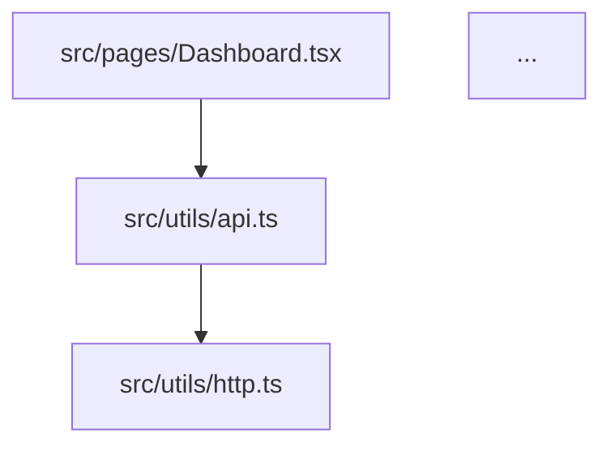

# dep-graph

Build a module dependency graph from source imports and report coupling metrics.

## Trigger

`/dep-graph` or when user asks for a dependency graph, import map, or coupling analysis.

## Steps

### 1. Discover Source Files

```bash
find src/ \
  -not -path "*/node_modules/*" \
  -not -path "*/.git/*" \
  -not -path "*/dist/*" \
  -not -path "*/build/*" \
  -not -path "*/__pycache__/*" \
  \( -name "*.ts" -o -name "*.tsx" -o -name "*.js" -o -name "*.jsx" -o -name "*.py" \) \
  2>/dev/null
```

If `src/` doesn't exist, also try scanning from project root (excluding `node_modules`, `dist`, `build`, `.git`).

### 2. Extract Imports Per File

For each file, extract all import/require statements:

**TypeScript/JavaScript patterns to extract:**
```
import ... from 'path'
import('path')
require('path')
export ... from 'path'
```

Use grep or read file content and parse with regex:
```
/(?:import|export)(?:\s+[\s\S]*?\s+from\s+)?['"]([^'"]+)['"]/g
/require\(['"]([^'"]+)['"]\)/g
/import\(['"]([^'"]+)['"]\)/g
```

**Python patterns:**
```
from module import ...
import module
```

Filter: keep only **relative imports** (starting with `.` or `./` or `../`) and **path-alias imports** (starting with `@/`, `~/`, or matching tsconfig paths).

Discard: bare module imports (e.g. `react`, `lodash`, `os`) — those are external packages, not internal dependencies.

### 3. Resolve Import Paths

For each extracted import path:

1. **Relative imports** (`./ ../`): resolve against the importing file's directory
2. **Extension resolution**: try `.ts` → `.tsx` → `.js` → `.jsx` → `/index.ts` → `/index.tsx` → `/index.js`
3. **Path aliases**: read `tsconfig.json` if present, extract `compilerOptions.paths`, resolve aliases
4. **Python**: treat dotted module paths as directory paths from project root

If a resolved path doesn't exist in the file list → mark as `UNRESOLVED` (external or missing file)

### 4. Build Adjacency List

```
graph = {
  "src/components/Button.tsx": ["src/utils/styles.ts", "src/hooks/useTheme.ts"],
  "src/utils/styles.ts": ["src/tokens/colors.ts"],
  ...
}
```

Exclude UNRESOLVED entries from graph (they are external).

### 5. Compute Metrics

For each file, compute:
- **in-degree**: count how many files import this file
- **out-degree**: count how many files this file imports
- **is-leaf**: out-degree === 0 (imports nothing — pure utility/leaf)
- **is-root**: in-degree === 0 (nothing imports it — entry point or dead code)

### 6. Output Summary

```
Dependency Graph Summary
═══════════════════════════════════════

Files analyzed: 47
Total import edges: 134

Top 10 Most-Imported Files (High Coupling Risk):
  #1  src/utils/api.ts              ← imported by 23 files
  #2  src/store/index.ts            ← imported by 18 files
  #3  src/components/ui/Button.tsx  ← imported by 15 files
  ...

Top 10 Files with Most Imports (Too Many Responsibilities):
  #1  src/pages/Dashboard.tsx       → imports 31 files
  #2  src/features/auth/index.ts    → imports 19 files
  ...

Entry Points (nothing imports these):
  src/index.ts
  src/main.tsx
  src/pages/App.tsx

Leaf Modules (import nothing):
  src/constants/colors.ts
  src/types/api.d.ts
  src/utils/format.ts
  ... (12 total)

High coupling risk: files with in-degree > 10 should be carefully managed.
Too many responsibilities: files with out-degree > 15 should be split.
```

### 7. Mermaid Diagram (optional)

If the user asks for a visual or diagram, output a Mermaid graph (limited to top 20 most-connected nodes to keep it readable):


